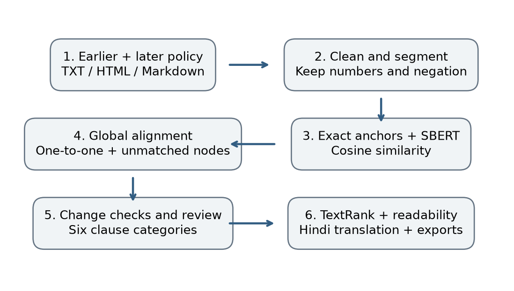
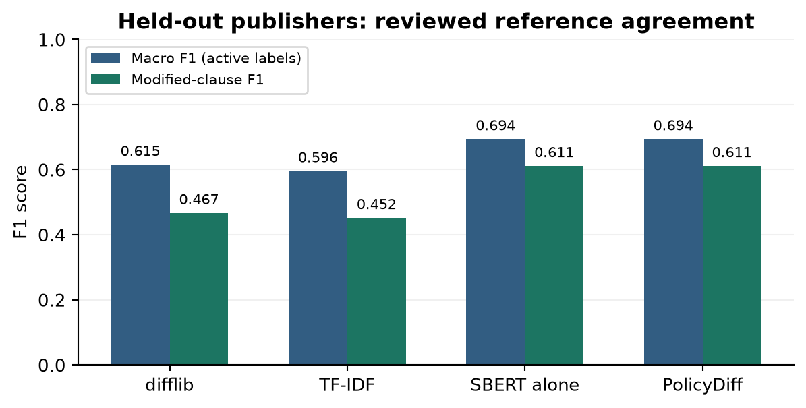
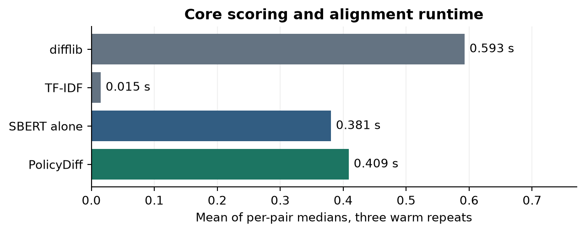
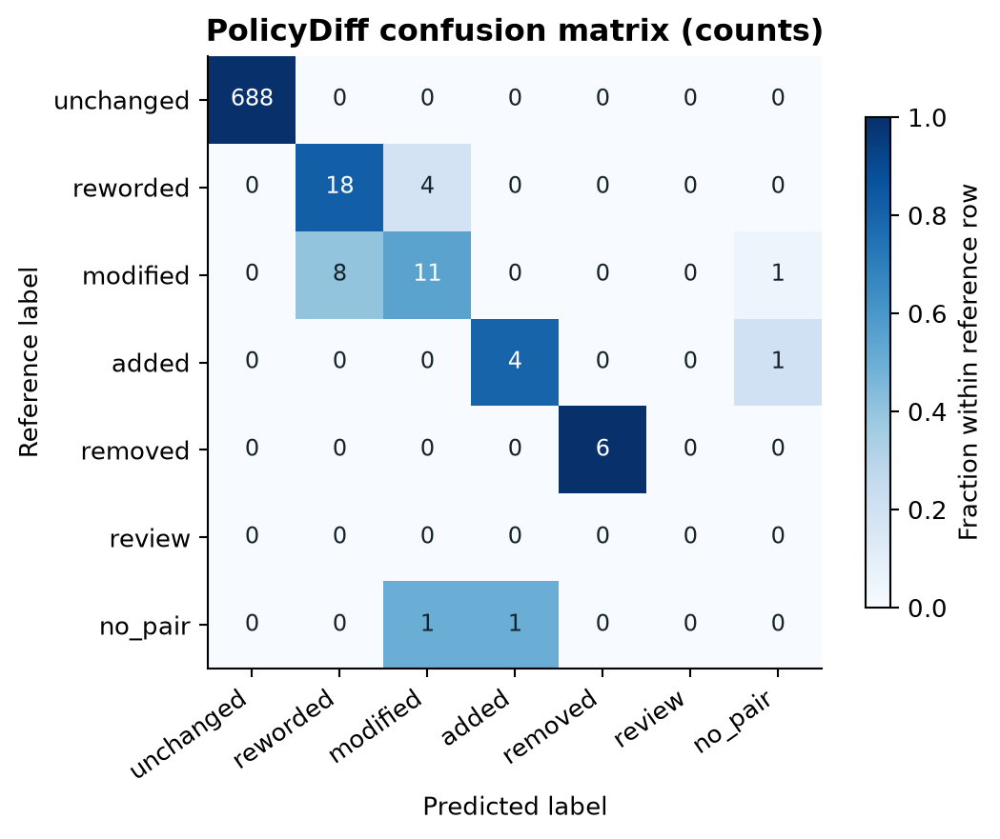
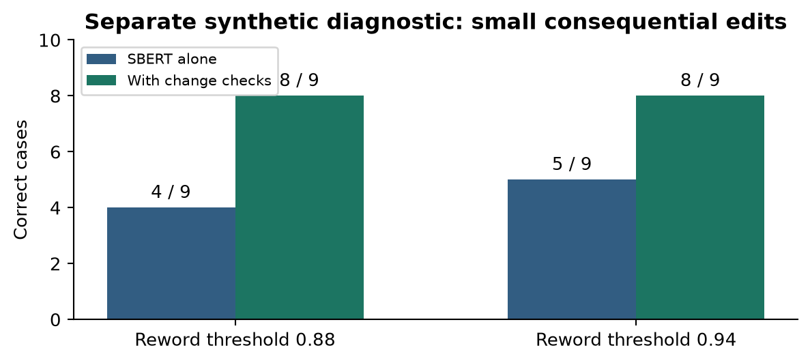
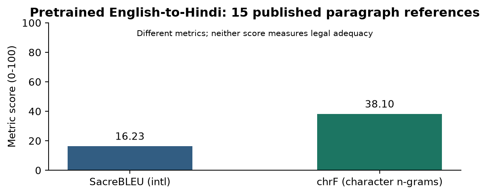
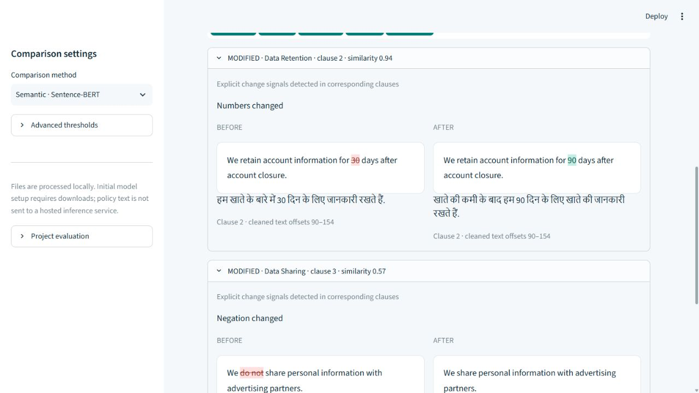
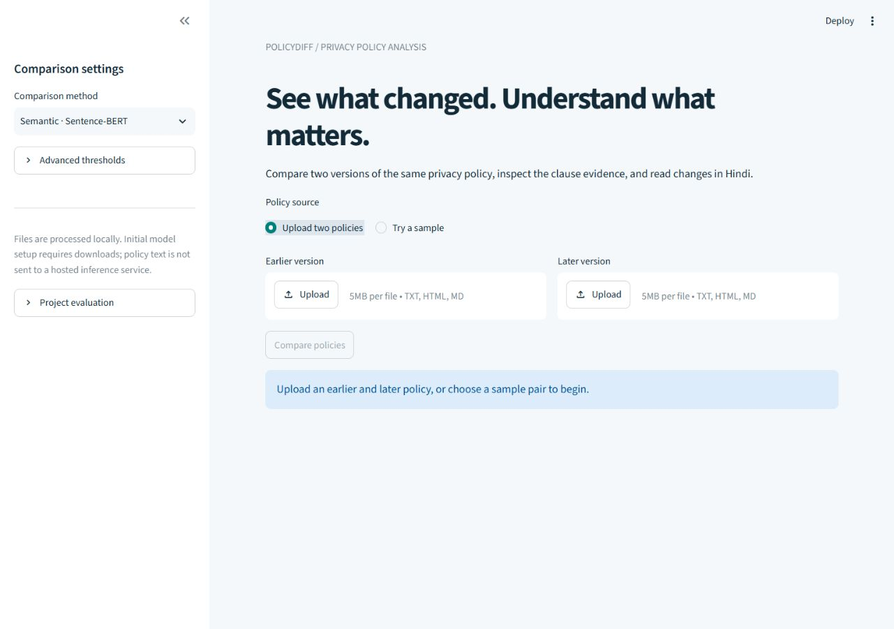
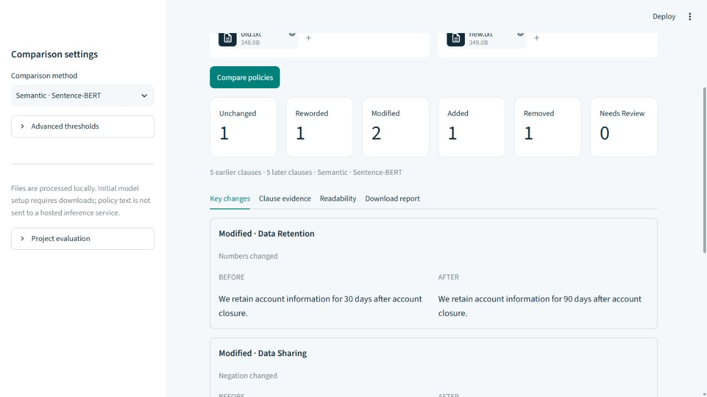
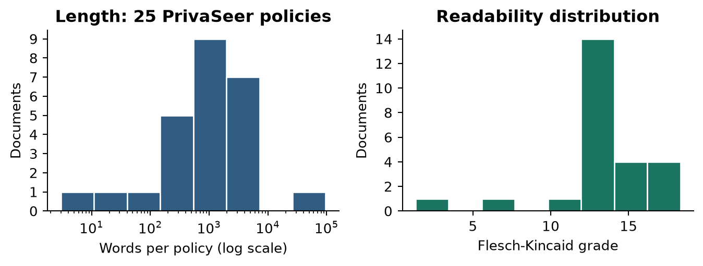

# PolicyDiff

Intelligent Privacy Policy Comparison and Semantic Change Analysis using NLP

Intelligent Privacy Policy Comparison and Semantic Change Analysis using NLP

Project report | Implementation, reproducible experiments, comparative analysis and accessibility

| Identity field | For manual entry |
| --- | --- |
| Subject | ____________________________ |
| TCODE | ____________________________ |
| Name | ____________________________ |
| PRN | ____________________________ |
| Branch | ____________________________ |
| Date | ____________________________ |
| Faculty Name | ____________________________ |

Project group: Shivam Bhartiya and Amit Tiparadi. Identity fields above remain blank for submission entry.

PolicyDiff compares two versions of a privacy policy using exact text anchors, sentence embeddings, cosine similarity and global clause alignment. Conservative checks preserve numbers, negation and modal wording. An extractive overview, readability scores and pretrained Hindi translation make detected changes accessible through a local upload interface. Experiments compare semantic and lexical methods on seven sourced historical pairs. Results are agreements with an AI-reviewed reference set, with independent human validation explicitly pending.

Scope: engineering research prototype. The contribution integrates existing pretrained models and algorithms; it does not introduce a newly trained language model.

## 1. Methodology and system workflow

The user supplies earlier and later versions of the same English policy. Loading removes presentation markup and document metadata while retaining sentence content and section context. Sentence-BERT encodes intact clauses; stemming and stopword removal are confined to a separate preprocessing experiment.

Exact normalized clauses are matched as a multiset, preserving repeated and reordered clauses. Residual clauses receive a similarity matrix. Hungarian assignment maximizes the total matching reward with dummy unmatched nodes. A 0.015 section-name bonus breaks close ties; scores below the match threshold remain unmatched.

For matched clauses, competing alternatives within a 0.04 margin trigger review. Otherwise critical wording changes trigger modified, high similarity triggers likely reworded, and remaining matches trigger modified. Unmatched earlier clauses are removed; unmatched later clauses are added. These are change candidates, not determinations of legal effect.

The summary ranks changed source clauses using a TF-IDF similarity graph with PageRank-style TextRank and explicit-change priority. It extracts at most five evidence items. Flesch scores describe prose difficulty. Marian English-to-Hindi translation runs on demand for both sides of changed clauses.

## 2. Datasets, preprocessing and models

| Dataset / publisher | Role | Size |
| --- | --- | --- |
| PrivaSeer local demo | Preprocessing/readability corpus | 4,000 TXT and 4,000 HTML snapshots |
| PrivaSeer deterministic sample | Included reproducible corpus profile | 25 loadable English policies |
| Google archive | Development: threshold selection | 3 version pairs |
| Mozilla policy Git history | Held-out evaluation publisher | 2 version pairs |
| Automattic policy Git history | Held-out evaluation publisher | 2 version pairs |
| Google published Hindi policy | Separate MT reference evaluation | 15 aligned paragraphs |

PrivaSeer contains individual policy snapshots, so the demo is not treated as a historical version-pair benchmark. Google pairs use publisher effective dates. Repository pairs use the last policy commit before each year-end in 2022, 2023 and 2024; Git author timestamps are not necessarily legal effective dates. Raw files, exact commit URLs, dates and SHA-256 hashes are retained. Princeton WebTAP and model fine-tuning are optional future extensions, not implemented results.

| Technique / model | Implementation |
| --- | --- |
| Cleaning / sentence boundaries | BeautifulSoup; Unicode quote/whitespace normalization; deterministic NLTK Punkt with abbreviations. |
| Preprocessing experiment | POS tagging on intact tokens before filtering; preserve numbers/negation; compare Porter stems and POS-aware WordNet lemmas. |
| Semantic representation | all-MiniLM-L6-v2, cosine similarity; bounded token chunks and weighted normalized pooling for long clauses. |
| Baselines and alignment | difflib SequenceMatcher, TF-IDF word/bigram cosine; shared global assignment and classification rules. |
| Summary / readability | Native TextRank implementation; textstat Flesch Reading Ease and Flesch-Kincaid grade. |
| Hindi / interface | Helsinki-NLP/opus-mt-en-hi (pretrained Marian); Streamlit; JSON/CSV/HTML exports. |

Model revisions are pinned in settings.py. Runtime inference reads cached weights only; setup downloads are explicit. Token-chunk pooling trades full-document context for bounded, complete clause coverage.

## 3. Evaluation design and reproducibility

| Publisher / date pair | Partition | Earlier / later clauses |
| --- | --- | --- |
| automattic-2022-12-30-2023-11-02 | test | 292 / 311 |
| automattic-2023-11-02-2024-04-22 | test | 311 / 311 |
| google-20190122-20191015 | development | 389 / 396 |
| google-20230701-20231004 | development | 422 / 421 |
| google-20240328-20240916 | development | 440 / 436 |
| mozilla-2022-12-14-2023-11-01 | test | 73 / 70 |
| mozilla-2023-11-01-2024-04-05 | test | 70 / 70 |

Reference coverage: 1999 scored correspondences, including 1930 exact anchors and 69 AI-reviewed non-exact rows. Labels: added=12, modified=22, removed=11, reworded=24, unchanged=1930.

10 earlier and 27 later clauses are excluded from primary one-to-one metrics in five explicitly documented groups: merged sentences, split legal-basis lists, controller tables, translation lists and an italic heading. Their source IDs and reasons remain in the manifest. Predictions touching those IDs are excluded; mistakes outside the groups are still penalized. These exclusions narrow the claimed scope.

Non-exact correspondences were reviewed against source text with rationale, using lexical candidate retrieval rather than semantic predictions. Exact anchors are automatic. Human-label columns are blank; these scores are not independently validated ground-truth accuracy. Before a stronger research claim, two people should annotate changed clauses, resolve disagreements and record agreement. The human-reviewed mode rejects incomplete review and preserves entered labels.

Threshold search uses only Google development pairs: match ∈ {0.40, 0.50, 0.55, 0.60, 0.70}, reword ∈ {0.80, 0.88, 0.94}, with ambiguity margin 0.04. Each method receives the same grid and shared alignment/classification. Baseline methods disable critical wording checks. SBERT alone isolates the representation; PolicyDiff adds checks. A second ablation fixes both semantic methods to the PolicyDiff thresholds.

Macro F1 averages active labels, including no_pair for missed/spurious correspondences. Precision, recall and F1 are also provided per label. Alignment precision/recall score the correspondence itself. Change precision/recall/F1 score non-unchanged correspondences, separate from correct semantic categorization. Confusion counts use the union of reference and predicted keys.

Runtime covers residual scoring and alignment only: three sequential warm repeats per held-out pair, median per pair, then mean across pairs. Model load, UI, readability and translation are excluded. No statistical significance claim is made.

Execution environment: Windows AMD64, 16 logical cores, cpu embedding device; Python 3.12.6, PyTorch 2.14.1. Exact package versions are in the dependency lock.

## 4. Results and comparative analysis

| Method | Macro F1 | Modified F1 | Alignment recall | Warm core (s) |
| --- | --- | --- | --- | --- |
| difflib | 0.615 | 0.467 | 0.995 | 0.593 |
| TF-IDF | 0.596 | 0.452 | 0.993 | 0.015 |
| SBERT alone | 0.694 | 0.611 | 0.997 | 0.381 |
| PolicyDiff | 0.694 | 0.611 | 0.997 | 0.409 |

PolicyDiff macro F1 is 0.694, versus 0.615 for difflib. Its modified-clause precision is 0.688 and recall 0.550. Semantic representations improve reference agreement in this small sample, while many material edits remain missed or ambiguous.

PolicyDiff and SBERT alone have identical historical macro F1 at the selected thresholds. The fixed-threshold ablation likewise shows no incremental F1 gain from the checks on this sample. That result supports retaining the checks as explainable diagnostics, without claiming proven historical accuracy improvement.

## 5. Error analysis and controlled ablation

Success example: Mozilla retention changes from four years to ten years and the vendor list expands; the system flags a modified clause. Failure example: Acoustic-to-Braze replacement in the later Mozilla pair has high semantic similarity and can be classified as reworded, despite a changed named processor. Proper-noun changes require better entity-sensitive checks.

Further failure cases are exported with source IDs, reference labels and predictions. Equivalent clause splits, merged sentences and Markdown tables can generate false additions/removals or review items. Multi-clause alignment and a richer document parser are clear next steps. Exact anchors dominate the corpus, so ordinary accuracy would obscure performance on changes.

The synthetic diagnostic isolates numeric periods, ages, duration units, negation, modality, data types, paraphrase, punctuation and exact text. At the selected reword threshold, checks improve correct cases from 5 to 8 out of nine. A permissive synonym change can also cause a false positive. These constructed cases demonstrate mechanisms, not generalization.

## 6. Hindi accessibility and translation evaluation

| Evaluation item | Measured value |
| --- | --- |
| Model | Helsinki-NLP/opus-mt-en-hi; pretrained only |
| Reference set | 15 publisher-written Hindi paragraphs from Google, March 28, 2024 |
| Corpus SacreBLEU (intl) | 16.23 |
| Corpus chrF | 38.10 |
| Translation time including load | 22.52 seconds |
| Reference authority | Publisher-written Hindi; alignment reviewed by AI; independent bilingual review pending |

Paragraph alignment was inspected before translation. Evaluation settings and signatures, model revision, source hash and all reference/output pairs are exported. Hindi prose may have multiple valid translations; low overlap is not automatically an incorrect translation. BLEU/chrF also do not establish preservation of legal negation, quantities or rights.

Changed English clauses remain visible beside Hindi. Both earlier and later versions are translated. Inputs are processed in bounded chunks and output-limit failures are surfaced. No Hindi model fine-tuning was performed; it remains an optional comparison after a larger independent bilingual evaluation.

Observed demo failure: the retention translation omits or poorly renders the account-closure condition, despite preserving the number of days. This shows why numeric preservation and reference-overlap scores alone cannot establish meaning preservation. Keep the English evidence and obtain bilingual review.

## 7. Implementation, contribution and novelty

The implemented contribution is an auditable workflow combining semantic matching, exact multiset anchors, global one-to-one assignment, conservative critical-wording checks, explicit ambiguity review and bilingual evidence. Numbers, units, negation and modal changes remain inspectable rather than disappearing during aggressive preprocessing. Exported reports retain clause IDs, sections, cleaned-text offsets and model revisions.

Sentence-BERT, TextRank, Hungarian assignment, Flesch scores and Marian translation are established techniques. Novelty is the project-specific integration and evidence-oriented interface. No claim is made that these algorithms or pretrained models were invented here.

Application behavior was checked through automated Streamlit tests and browser interaction, including semantic comparison and Hindi translation. Uploaded markup is escaped in highlights, CSV cells are sanitized, input size/clause limits are enforced, and missing models cause visible errors. No hosted inference endpoint receives policy text.

## 8. Corpus exploration and preprocessing evidence

Twenty-five loadable PrivaSeer demo policies were selected in filename order and profiled for word count, numeric tokens, Flesch Reading Ease and Flesch-Kincaid grade. Rejected empty/non-English files encountered during selection are recorded. Sample documents and hashes are included for reproducibility. The full locally available demo is retained separately.

| Preprocessing choice | Reason / demonstrated behavior |
| --- | --- |
| Keep numeric tokens | Retention periods, ages and durations can carry meaning. Numeric counts are included in corpus_profile.csv. |
| Tag before filtering | POS tagging sees intact tokens, punctuation and sentence context before normalization/removal. |
| Map Penn tags to WordNet POS | Verb retained becomes retain; unknown pronoun POS remains us rather than u. |
| Normalize Unicode punctuation | Smart quotes are handled separately from ASCII punctuation. |
| Preserve semantic prose | SBERT and readability receive grammatical clause text, not stems or stopword-stripped sequences. |

The token experiment CSV preserves token, POS tag, stem, lemma and clause ID for direct lab inspection. This replaces the standalone assignment script within the maintained project package. Corpus profiling, baseline comparison and historical evaluation have separate documented roles.

Summary quality is demonstrated with source-preserving output and a regression check that consequential numeric edits precede centrality. An independent summary-coverage study was not performed, so no ROUGE or fabricated summary-quality score is reported. Readability scores likewise describe linguistic complexity rather than policy fairness.

## 9. Reproduction, submission mapping and limitations

| Step | Windows command / artifact |
| --- | --- |
| Install | python -m venv .venv; install requirements-lock.txt with .venv/Scripts/python.exe -m pip |
| Explicit setup | python -m scripts.setup_models; python -m scripts.source_data |
| Run interface | python -m streamlit run app.py |
| Core verification | python -m pytest -q; python -m scripts.verify_project |
| Evaluation | python -m scripts.benchmark; python -m scripts.stress_eval; python -m scripts.translation_eval |
| Corpus / report | python -m scripts.corpus_profile; install requirements-report.txt; python -m scripts.build_submission |

Commands above use the project virtual-environment Python on Windows; the README supplies exact runnable commands. Historical and Hindi source snapshots, provenance, annotations, model pins and a dependency lock are included. Initial downloads need internet. Model weights and the virtual environment are excluded from the compact submission archive.

| Rubric | Evidence supplied |
| --- | --- |
| Methodology & Workflow | Section 1, workflow figure, source loader, segmentation and alignment. |
| Dataset, Techniques & Models | Section 2, corpus profile, publisher provenance, pinned pretrained models. |
| Implementation & Novelty | Section 7, local upload demo, Hindi evidence, documented integration contribution. |
| Results & Evaluation | Sections 3-6 and 8, labelled reference set, precision/recall/F1, confusion matrix, runtime, BLEU/chrF, error cases. |
| Comparative Analysis | Section 4, three baselines, shared tuning protocol, fixed-threshold and synthetic ablations. |

Independent human annotation and bilingual adequacy review remain pending. Development changes are few, the held-out publishers are only two, one-to-many groups are excluded, and thresholds may not generalize. Word-number normalization, entity/vendor sensitivity, clause split/merge matching and stronger parsing should be evaluated on a larger independently labelled set.

The report uses blank identity fields in a neutral academic layout. The official SIT Assignment-01 Word template was not present, so its exact formatting is not claimed. The existing dataset is retained; redundant assignment and superseded scripts have been removed.

## 10. References and artifact index

1. [PrivaSeer corpus paper](https://aclanthology.org/2021.acl-long.532/)

2. [PrivaSeer source repository](https://git.psu.edu/hlt-lab/PrivaSeer-Corpus)

3. [Sentence-BERT, Reimers and Gurevych (2019)](https://aclanthology.org/D19-1410/)

4. [all-MiniLM-L6-v2 model card](https://huggingface.co/sentence-transformers/all-MiniLM-L6-v2)

5. [TextRank, Mihalcea and Tarau (2004)](https://aclanthology.org/W04-3252/)

6. [Helsinki-NLP English-to-Hindi model card](https://huggingface.co/Helsinki-NLP/opus-mt-en-hi)

7. [Google publisher archive](https://policies.google.com/privacy/archive)

8. [Mozilla publisher history](https://github.com/mozilla/legal-docs)

9. [Automattic publisher history](https://github.com/Automattic/legalmattic)

10. [Published Hindi reference](https://policies.google.com/privacy/archive/20240328?hl=hi)

11. [SacreBLEU implementation and metric signatures](https://github.com/mjpost/sacrebleu)

| Location | Contents |
| --- | --- |
| policydiff/ | Reusable analysis, text, model and export modules. |
| scripts/ | Sourcing, setup, verification, benchmark, diagnostics and report builder. |
| data/benchmark/ | Reviewed decisions, rationale, source text, blank human-review fields, manifest and Hindi source. |
| data/historical/ | Seven historical pairs with provenance. |
| data/corpus_sample/ | 25 PrivaSeer snapshots and sample-selection provenance. |
| submission/results/ | Comparative metrics, translation examples, corpus profile and error cases. |
| submission/figures/ | Workflow, measured plots and actual browser screenshots. |
| submission/DEMO_GUIDE.md | Short demonstration and viva guide. |

All reported numeric scores are read from generated JSON/CSV outputs. The report can be rebuilt from these records. Source-linked evidence and explicit limitations support review without claiming independent validation that has not occurred.
